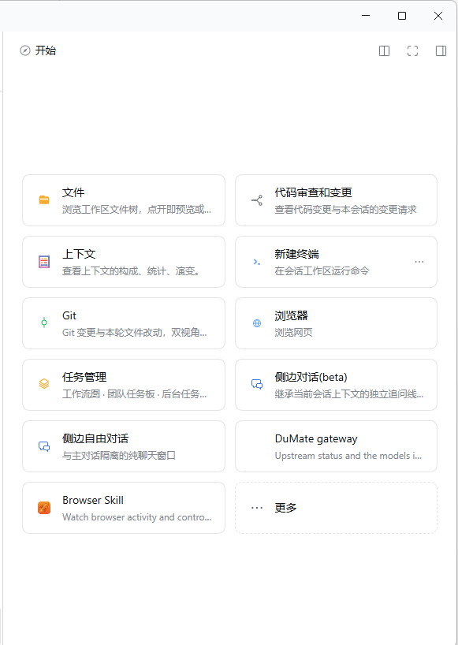
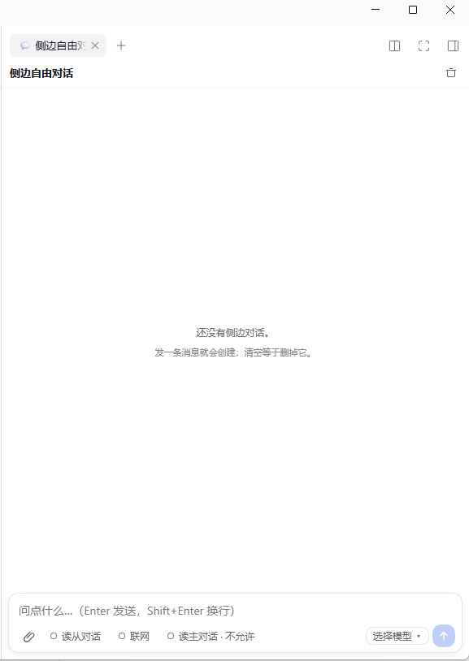
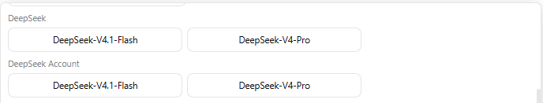
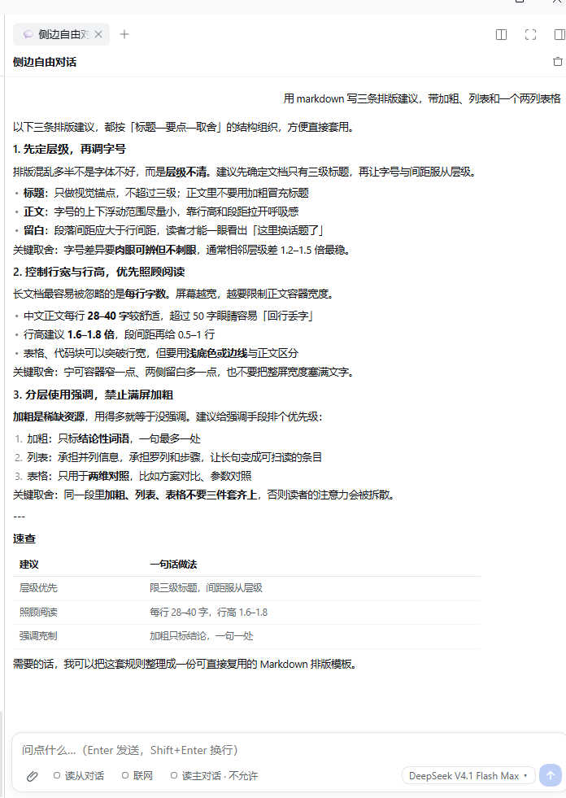

# Side Freedom Chat (dsh-freedomchat)

**A chat-only panel in the right sidebar of every session — talk, don't touch.**

[中文](README.zh-CN.md) · [Detailed guide](docs/DETAIL.md) · [Contract](docs/contract.md)

---

Your main session is busy running a task. You want a quick question answered, an idea pushed around, or a second model's opinion — without dumping that chatter into the main context and without handing it access to your files.

This plugin adds an **isolated conversation panel**: empty context, zero local execution, its own model, two-way reading that always needs your explicit consent, and no effect on the main session the moment you close it.

## Screenshots

| Sidebar entry | Empty panel |
| --- | --- |
|  |  |

| Model picker | In use |
| --- | --- |
|  |  |

## Features

- **A real right-sidebar tab**: one per session, opened like the built-in sidebar tabs. A session has at most one side thread, even across windows.
- **Empty context**: it inherits nothing and cannot see the main session unless you allow it.
- **Zero local execution**: no built-in tools in the side thread; the host rejects any tool call before it runs.
- **Model and reasoning effort**: a card picker grouped by provider. Defaults to the main session's current model and never changes your global default.
- **Images**: paperclip or paste (png / jpeg / webp / gif, up to 8 per message).
- **Web on demand**: off by default; when on, only `web_search` / `web_fetch` / `research` are allowed.
- **Two-way reading, both explicit**:
  - *Read from the panel* switch → the main session gains a reading tool, and only for a turn where you explicitly ask it to read the side chat.
  - *Read the main session* three-state pill (Allow / Ask / Deny) → reverse reading; "Ask" shows a confirmation bar that times out after two minutes.
- **Closed means gone**: closing the panel unloads the reading tool immediately.
- **Clear means delete**: clearing removes the thread and its transcript; the next message starts a fresh one.
- **Lifecycle**: transcripts cold-resume after a restart; archiving the parent deletes the side thread and leaves a tombstone; deleting the parent cleans up too.

## Compared with the built-in Side chat (beta)

| | Side Freedom Chat | Side chat (beta) |
| --- | --- | --- |
| Context | Empty, inherits nothing | Inherits the full main history |
| Tools | No local execution | Follows the parent preset |
| Model | Per panel | Inherited |
| Clear | Deletes the thread | Starts a new thread |
| Archive | Deleted with the parent | Disabled |

Both can be open at the same time.

## Install

Requires DSH `>= 0.2.2-rc.3` and Node `>= 22` (Desktop or Web).

No companion plugin is needed. The panel lives in the host's own right sidebar (`@deepseek-ai/dsh-client-ui-sidebar-right`), so it appears with or without [`dsh-better-sidebar`](https://github.com/JohnXu22786/dsh-better-sidebar) — both can be installed and open side by side. If the right sidebar is collapsed, open it from the session header first.

From a release:

```sh
dsh plugin --profile desktop add https://github.com/qiuyunhui666-sketch/dsh-freedomchat/releases/download/v0.1.0/dsh-freedomchat-0.1.0.tgz
```

From a local checkout:

```sh
dsh plugin --profile desktop add link:D:/DSH/work/dsh-freedomchat
```

Restart DSH afterwards.

## Usage

1. Open **Side Freedom Chat** in the right sidebar of any session.
2. Send a message — the thread is created on the first message, not on mount.
3. Use the model pill to change model or reasoning effort.
4. Paste or attach images.
5. Turn on *Read from the panel*, then say "read the side chat" in the main session.
6. Set *Read the main session* to Allow or Ask for reverse reading.
7. The trash button deletes the thread.

## Security model

- The side thread's allow-list is **empty** and a host-level `tools/pre-execute` gate rejects anything that slips through.
- Reading tools are mounted **on demand** and unloaded when the panel or switch is off — they do not exist in the main session's tool list otherwise.
- Reads carry the last 20 **user/assistant** messages only; tool calls and results are never transferred.
- Web tools are opt-in and limited to three names.

## Data

- Registry: `~/.dsh/freedomchat/threads.json` (mapping, switches, model).
- Transcripts: `~/.dsh/sessions/<project>/<session id>/`, like any other session.
- No telemetry; only the web tools you enable reach the network.

## How it works

The host half (`lib/index.js`) exposes an HTTP route `/freedomchat/api` with `ensure` / `peek` / `snapshot` / `send` / `cancel` / `clear` / `settings` / `resolveApproval` / `catalog` / `setModel` / `revive`. Side threads are created with `agents.create` (blank seed, `origin: 'subagent'`, `parentSession` pointing at the main session); streaming text comes from `agent/assistant-stream` and durable events from `session/event`. The client half (`lib/client.js`) is build-free: it registers the `sidebar.right.pane.tab` slot and draws the panel itself.

See [docs/contract.md](docs/contract.md) for the full contract.

## Development

```sh
node scripts/smoke.mjs          # client loader / slot registration
node scripts/render-smoke.mjs   # fake-React render assertions
node scripts/host-smoke.mjs     # host API, including cold resume in a sandbox
node scripts/install-dev.mjs    # link into the current profile
```

## Known limitations

- With the panel closed, the reading tool is absent, so asking the main session to read then yields `unknown tool` — the cost of "closed means no effect".
- Archive detection polls once a second; an archive undone within that second can be missed.
- `origin: subagent` sessions are not listed in the DSH session list (host behaviour), so the side thread lives only in its panel.

## License

MIT
