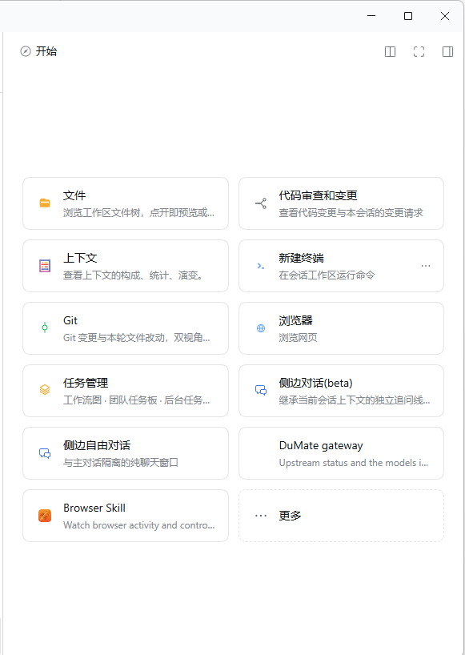
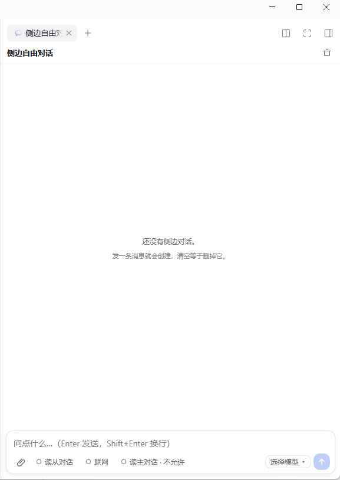
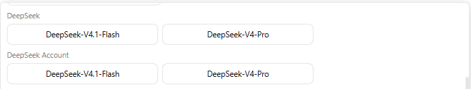
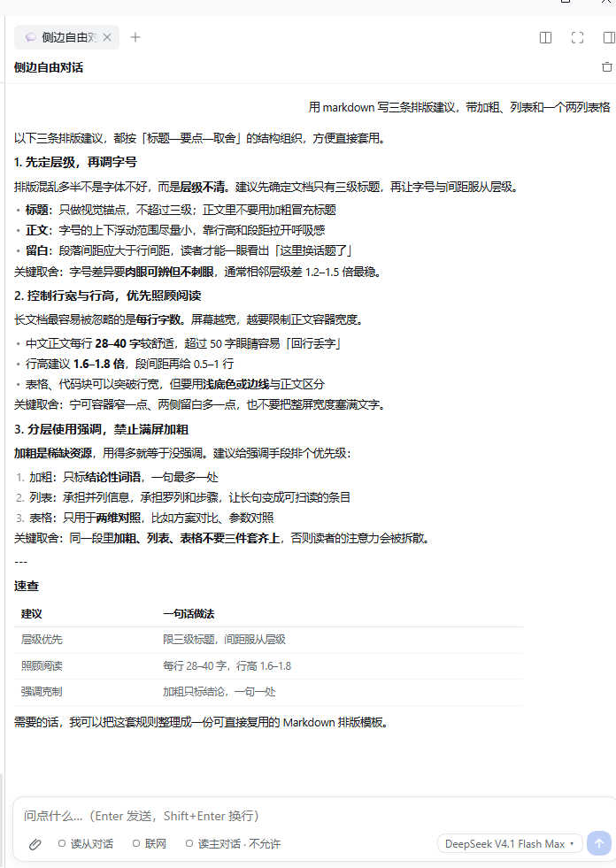

# 侧边自由对话 (Freedom chat)

**在主对话的右侧栏，开一个只聊天、不干活的独立窗口。**

[English](README.md) · [详细说明](docs/DETAIL.zh.md) · [架构契约](docs/contract.md)

---

主对话在跑任务，你想顺手问一句、推演一个思路，或者让另一个模型换个角度看看——但不想把这段闲聊塞进主对话上下文，也不想让它有机会动你的文件。

这个插件提供一个**与主对话隔离**的对话面板：空白上下文、零本地执行、独立模型、双向读取全部需要你明确点头，关闭面板后对主对话毫无影响。

## 截图

| 侧边栏入口 | 空面板 |
| --- | --- |
|  |  |

| 选模型 | 对话中 |
| --- | --- |
|  |  |

## 它做什么

- **右侧栏标签页**：每个主对话一条「💬 侧边自由对话」，一个主对话只有一条，多窗口也不会重复创建。
- **空白上下文**：不继承主对话历史，也读不到主对话，除非你授权。
- **零本地执行**：侧边会话没有任何内置工具；即使模型尝试调用，宿主也会在执行前拒绝。
- **自选模型与推理强度**：卡片式选择器按来源分组；默认继承主对话当前模型，改动不影响全局默认。
- **图片**：回形针选择，或直接粘贴进输入框（png / jpeg / webp / gif，单条最多 8 张）。
- **联网按需**：默认关闭；开启后只放行 `web_search` / `web_fetch` / `research`。
- **双向读取**：
  - 面板里的「读从对话」开关 → 主对话获得读取能力；且只在你本轮明确说「读一下侧边对话」时才放行。
  - 面板里的「读主对话」三态（允许 / 询问 / 不允许）→ 反向读取；选「询问」会在读取前弹出确认条，2 分钟超时按拒绝处理。
- **关闭即失效**：面板一关，主对话里的读取工具立即卸载。
- **清空即删除**：删除这条侧对话及其记录，下一条消息再新建，不留垃圾子会话。
- **跟随生命周期**：重启后冷恢复聊天记录；主对话归档则侧对话删除并显示墓碑；主对话删除则一并清理。

## 与内置「侧边对话(beta)」的区别

| | 侧边自由对话 | 侧边对话(beta) |
| --- | --- | --- |
| 上下文 | 空白，不继承 | 继承主对话全部历史 |
| 工具 | 零本地执行 | 沿用主对话预设 |
| 模型 | 每面板独立 | 继承 |
| 清空 | 删除记录 | 新建线程 |
| 归档 | 随主对话删除 | 禁用归档 |

两者可同时打开，互不影响。

## 安装

要求：DSH `>= 0.2.2-rc.3`、Node `>= 22`（桌面版 / 网页版均可）。

不需要先装任何配套插件：面板用的是宿主自带的右侧栏（`@deepseek-ai/dsh-client-ui-sidebar-right`），装不装 `dsh-better-sidebar` 都能出现，两者也可以同时安装、同时打开。右侧栏处于收起状态时，先在标题栏把侧边栏展开。

从 Release 安装：

```sh
dsh plugin --profile desktop add https://github.com/qiuyunhui666-sketch/dsh-freedomchat/releases/download/v0.1.2/dsh-freedomchat-0.1.2.tgz
```

从本地目录安装（开发用）：

```sh
dsh plugin --profile desktop add link:D:/DSH/work/dsh-freedomchat
```

安装后重启 DSH 生效。

## 使用

1. 打开任意主对话的右侧栏 →「💬 侧边自由对话」。
2. 发消息：第一条消息才会创建会话（空面板不产生垃圾）。
3. 点模型胶囊换模型 / 推理强度。
4. 粘贴或回形针加图片。
5. 「读从对话」开关 + 在主对话里明说「读一下侧边对话」→ 主对话才能拿到内容。
6. 「读主对话」切到允许/询问 → 反向读取。
7. 垃圾桶 = 删除这条侧对话。

## 安全边界

- 侧边会话工具白名单**为空**；宿主在 `tools/pre-execute` 上有硬闸门，绕过可见性也会被拒。
- 读取工具**按需挂载**：面板关闭或开关关闭即卸载，主对话工具列表里根本不存在。
- 读取范围固定为主对话最近 20 条**用户/助手正文**，工具调用与结果不会被带过去。
- 联网工具默认关闭，开启后也只有三个名字。

## 数据

- 注册表：`~/.dsh/freedomchat/threads.json`（映射、开关、模型）。
- 会话记录：`~/.dsh/sessions/<项目段>/<会话 id>/`（与其它 DSH 会话一致）。
- 无遥测；只有你显式打开的联网工具会访问网络。

## 实现概要

宿主半部（`lib/index.js`）通过 HTTP 路由 `/freedomchat/api` 暴露 `ensure` / `peek` / `snapshot` / `send` / `cancel` / `clear` / `settings` / `resolveApproval` / `catalog` / `setModel` / `revive`；子会话由 `agents.create`（空白 seed、`origin: 'subagent'`、`parentSession` 指向主会话）创建，流式文本来自 `agent/assistant-stream`，持久事件来自 `session/event`。客户端半部（`lib/client.js`）零构建，注册 `sidebar.right.pane.tab` 槽位并自绘面板。

细节见 [docs/contract.md](docs/contract.md)。

## 开发

```sh
node scripts/smoke.mjs          # 客户端 loader / 槽位注册
node scripts/render-smoke.mjs   # 假 React 渲染断言（开关、确认条、模型卡片、墓碑）
node scripts/host-smoke.mjs     # 宿主半部 API（含沙盒重启冷恢复）
node scripts/install-dev.mjs    # 链接到当前 profile
```

## 已知限制

- 面板关闭时读取工具不存在，此时让主对话去读会看到 `unknown tool`（「面板关＝零影响」的代价）。
- 归档检测是 1 秒轮询，1 秒内归档又取消的极端情况抓不到。
- `origin: subagent` 的会话不出现在 DSH 会话列表（宿主行为），侧对话只能在面板里查看。

## 许可证

MIT
